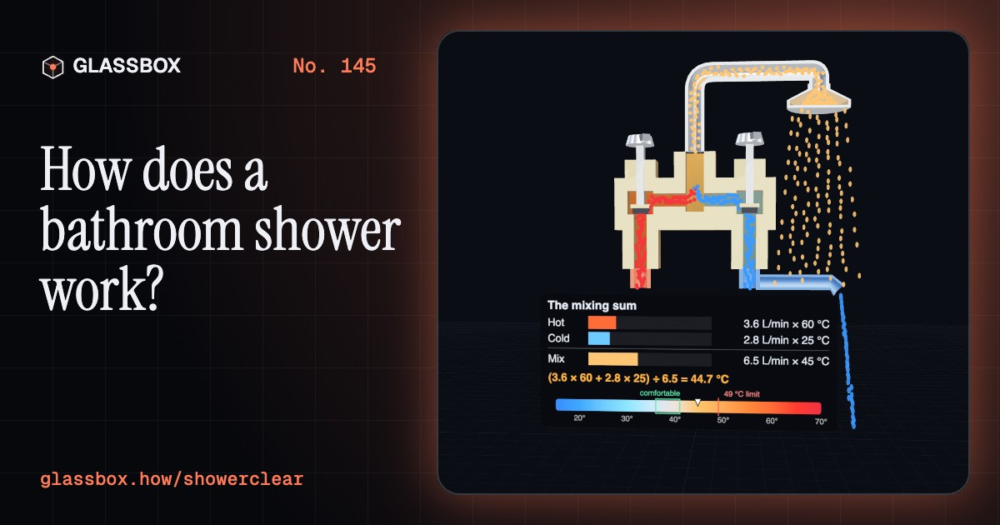
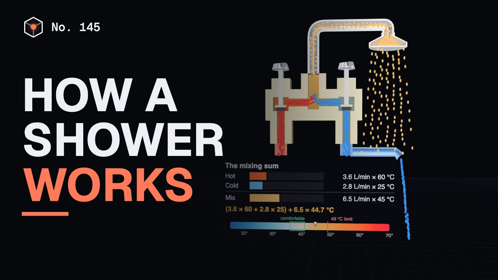
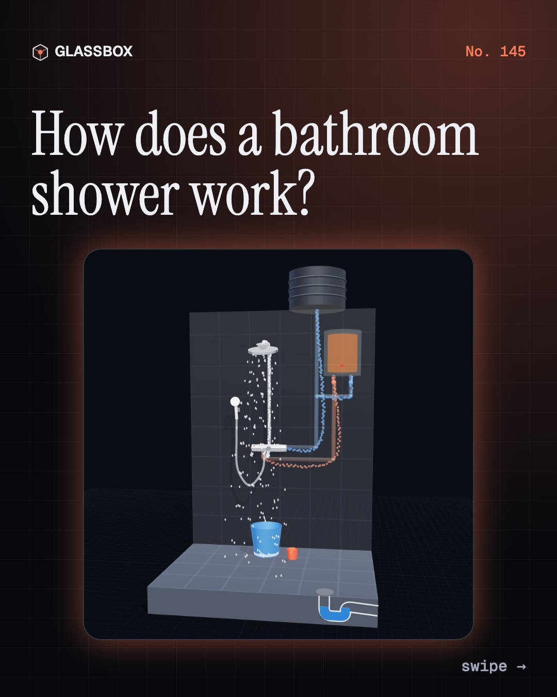
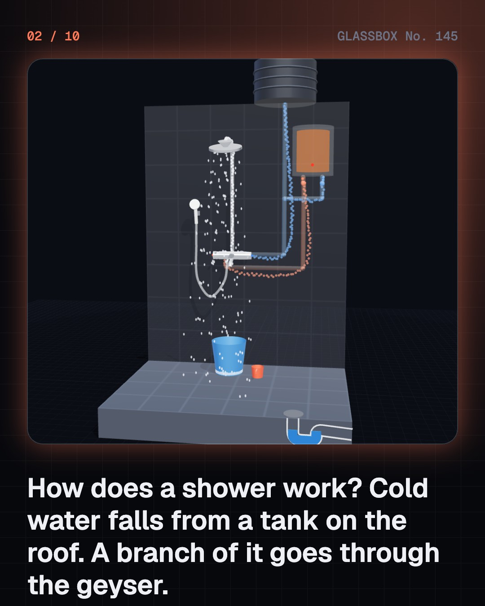
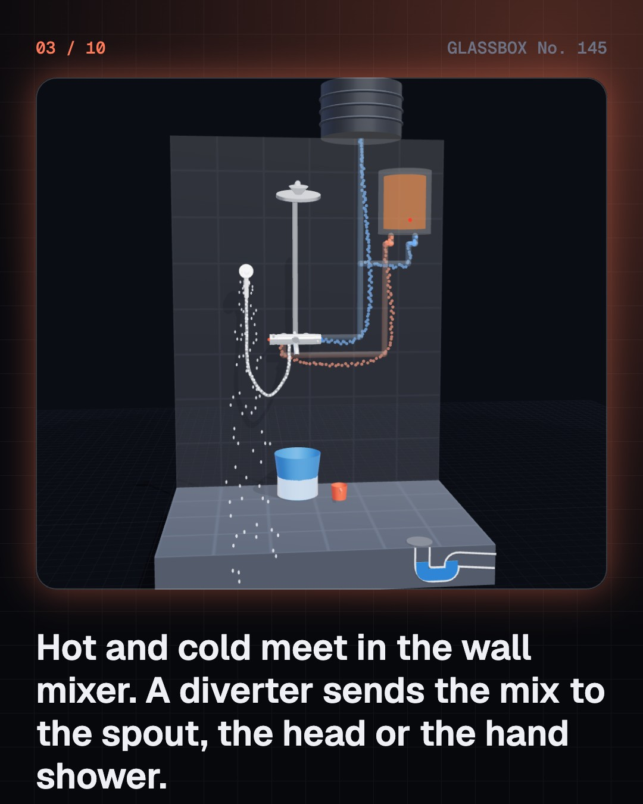
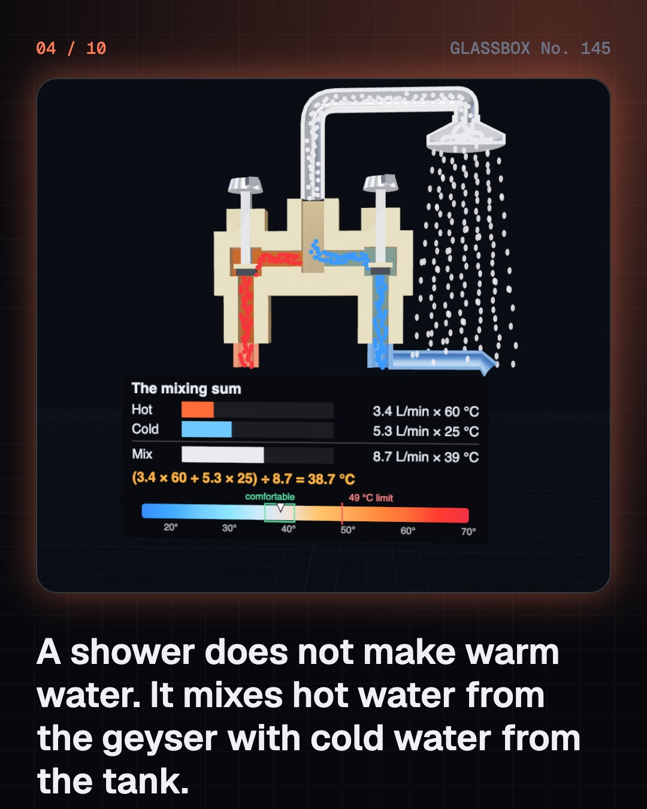

<!-- glassbox:start -->
<!-- Generated from glassbox.json by the Glassbox hub (npm run readme -- showerclear). Edit glassbox.json, not this block. -->
<p align="center"><a href="https://glassbox.how/e/showerclear/"></a></p>

<h1 align="center">ShowerClear</h1>

<p align="center"><b>How does a bathroom shower work?</b><br>A shower makes no warm water of its own: it mixes two streams and throws the result through sixty tiny holes. See the mixing sum, the wax capsule and the sliding spool that stop it scalding you, and why a rain shower dribbles under an overhead tank.</p>

<p align="center"><a href="https://glassbox.how/showerclear/"><b>▶ Play with it</b></a> &nbsp;·&nbsp; <a href="https://glassbox.how/e/showerclear/">Read the 60-second explainer</a> &nbsp;·&nbsp; <a href="https://glassbox.how/showerclear/glassbox/reel.mp4">Watch the 40-second video</a></p>

<p align="center">
  <a href="https://glassbox.how/e/showerclear/"></a>
  <a href="https://glassbox.how/e/showerclear/"></a>
  <a href="LICENSE"></a>
  <a href="LICENSE-CONTENT.md"></a>
  <a href="#privacy"></a>
</p>

## In 60 seconds

1. **Two pipes in, three ways out.** Cold water comes down from the overhead tank, and a branch of it goes through the geyser. Hot and cold meet in the wall mixer, and a diverter sends the mix to the spout, the overhead head or the hand shower. A bend of water in the floor trap keeps sewer gas out.
2. **Warm water is a sum.** Outlet temperature = (hot flow × hot temperature + cold flow × cold temperature) ÷ total flow. Three litres a minute at 60 °C with five at 25 °C gives eight litres a minute at 38 °C. Open another cold tap and the cold pressure dips, so the mix jumps hotter.
3. **A spool that balances pressure.** A pressure-balancing valve has a piston that slides towards whichever side is weaker and pinches the stronger one. The pressures behind it stay equal, so the hot-to-cold share holds. The shower goes weaker for a moment, not hotter.
4. **Wax that feels the water.** A thermostatic valve keeps a capsule of wax in the mixed water. Warm wax swells and pushes a shuttle that narrows the hot gap and widens the cold one. If the cold supply fails, it shuts the hot off completely.
5. **Holes turn pressure into speed.** Nozzles trade pressure for speed: 0.14 bar inside a needle head throws jets out at 4.5 metres a second, and surface tension beads them into drops about 16 cm below. A rain shower has so much open area that an overhead tank can only make it dribble.
6. **Litres, units and scalds.** Water used is litres a minute times minutes: eight minutes at 9 L/min is 72 litres, five buckets, against one for a bucket bath. Heating it from 20 to 38 °C takes about 1.6 units of electricity. At 60 °C water burns skin in about five seconds, so store hot and mix down.

## Words worth knowing

| Term | Meaning |
|---|---|
| **Mixing equation** | Outlet temperature = (hot flow × hot temperature + cold flow × cold temperature) ÷ total flow. |
| **Wall mixer** | A fitting with a hot inlet, a cold inlet and valves that set how much of each flows into one outlet. |
| **Diverter** | A small valve that sends the mixed water to the spout, the overhead shower or the hand shower. |
| **Pressure-balancing valve** | A shower valve whose sliding spool keeps the hot and cold pressures equal, so the mix does not change when one supply dips. |
| **Thermostatic valve** | A valve in which a wax capsule senses the mixed water and moves a shuttle to hold the temperature you set. |
| **Head of water** | The height of the water surface above the outlet. Every metre gives about 0.1 bar of pressure. |
| **Nozzle** | A small hole that turns the pressure behind it into a fast jet; jet speed is about √(2 × pressure ÷ density). |
| **Surface tension** | The pull between water molecules at a surface, which pinches a thin jet into drops. |
| **Scald** | A burn from hot liquid. Adult skin is seriously burned in about 5 minutes at 49 °C and about 5 seconds at 60 °C. |

## A short history

**4,500 years from a jar of water poured on a brick floor to a valve that mixes, measures and protects.**

- **2500 BCE** · Bathing floors with drains (Builders of the Indus cities, Mohenjo-daro and Harappa (today Pakistan))
- **520 BCE** · Showers painted on a Greek jar (Attributed to the Antimenes Painter, Athens, Greece)
- **1767** · The first patented shower (William Feetham, London, England)
- **1872** · Showers for a prison (François Merry Delabost, Rouen, France)
- **1883** · A bath for ten pfennigs (Oskar Lassar, Berlin, Germany)
- **1913** · A valve that holds the temperature (Frederick Leonard, Brooklyn, New York, then Rhode Island, USA)
- **1928** · The hand shower (Hans Grohe, Schiltach, Germany)
- **1934** · A capsule of wax that pushes (Sergius Vernet, USA)

The full story, with 30 moments, charts, people and 41 sources: [glassbox.how/e/showerclear/history](https://glassbox.how/e/showerclear/history/). The data lives in [`history.json`](history.json).

## Video and slides

Made with the Glassbox studio from this box's storyboard (`window.glassbox.director`). Free to reuse under CC BY 4.0.

<a href="https://glassbox.how/showerclear/glassbox/video.mp4"></a>

<p><a href="glassbox/slide-1.jpg"></a> <a href="glassbox/slide-2.jpg"></a> <a href="glassbox/slide-3.jpg"></a> <a href="glassbox/slide-4.jpg"></a></p>

| File | What | Size |
|---|---|---|
| [`glassbox/reel.mp4`](https://glassbox.how/showerclear/glassbox/reel.mp4) | Reel / Short, with captions and soundtrack | 1080×1920 |
| [`glassbox/video.mp4`](https://glassbox.how/showerclear/glassbox/video.mp4) | YouTube video, with captions and soundtrack | 1920×1080 |
| `glassbox/slide-1…10.jpg` | Instagram carousel | 1080×1350 |
| `glassbox/thumb.jpg` | YouTube thumbnail | 1280×720 |
| `glassbox/cover.jpg` | Share card and repo social preview | 1200×630 |
| [`glassbox/history-reel.mp4`](https://glassbox.how/showerclear/glassbox/history-reel.mp4) | “History in 10 moments” Reel / Short | 1080×1920 |
| `glassbox/history-slide-*.jpg` | History carousel | 1080×1350 |
| `glassbox/post.json` | Post copy and schedule used by the publish kit | |

## Privacy

This box has no accounts and no ads, and it ships its own fonts and libraries. When you run it yourself it sends nothing anywhere. On glassbox.how, the site's `/bar.js` also loads Glassbox's analytics: **Google Analytics** to count visits (it asks first in the EU, UK and Switzerland, and stays off when your browser sends Global Privacy Control or Do Not Track) and **ClickTrust** to detect bots.

It remembers a few things **in your own browser only**, and never sends them anywhere:

| Browser storage key | What it holds |
|---|---|
| `showerclear.v1` | Which chapters you have opened, your best quiz scores, and sound on or off. |

Exactly what each one sees is at [glassbox.how/privacy](https://glassbox.how/privacy/).

## Licences

- **Code:** [MIT](LICENSE). Use it, change it, ship it.
- **Explanations, text, images and videos** (`glassbox.json`, `glassbox/`): [CC BY 4.0](LICENSE-CONTENT.md). Credit “Glassbox, glassbox.how/e/showerclear”.
- **Third-party parts** keep their own licences: [three.js](https://threejs.org) (MIT), [Geist, Instrument Serif](https://openfontlicense.org) (SIL OFL 1.1).
- The Glassbox name and logo aren't covered by either licence. See the [terms](https://glassbox.how/terms/).

Found a mistake? [Open an issue](https://github.com/bdeeps/showerclear/issues). Corrections happen in public.
<!-- glassbox:end -->

## Run it

It's plain HTML, CSS and JavaScript. No build step and no dependencies. Run locally, it contacts no other website.

```bash
python3 -m http.server 8000
```

Three.js and the fonts ship in `vendor/` and `fonts/`, so it also works offline.

Then open http://localhost:8000.

## How it's built

| File | What |
|---|---|
| `index.html`, `css/app.css` | The page and its styles |
| `js/app.js`, `js/stage.js`, `js/ui.js`, `js/kit.js` | The shared Glassbox 3D engine: chapters, 3D stage, controls, quiz, video director |
| `js/chapters/*.js` | One file per chapter: the 3D model, controls, text, key terms, quiz and video scenes |
| `js/shower.js` | Shared physics and parts: the two-inlet mixing network and mixing equation, scald times, shower-head jets and their break-up into drops, shower energy, and builders for sectioned valve bodies, flowing water and spray |
| `glassbox.json` | Title, question, explainer beats, key terms, browser storage and credits shown on glassbox.how |
| `reel` in each chapter | The storyboard the Glassbox studio records into short videos |
| `glassbox/` | The published video, slides, thumbnail and post copy |
| `fonts/`, `vendor/three/` | Self-hosted Geist and Instrument Serif (SIL OFL 1.1) and three.js (MIT) |
